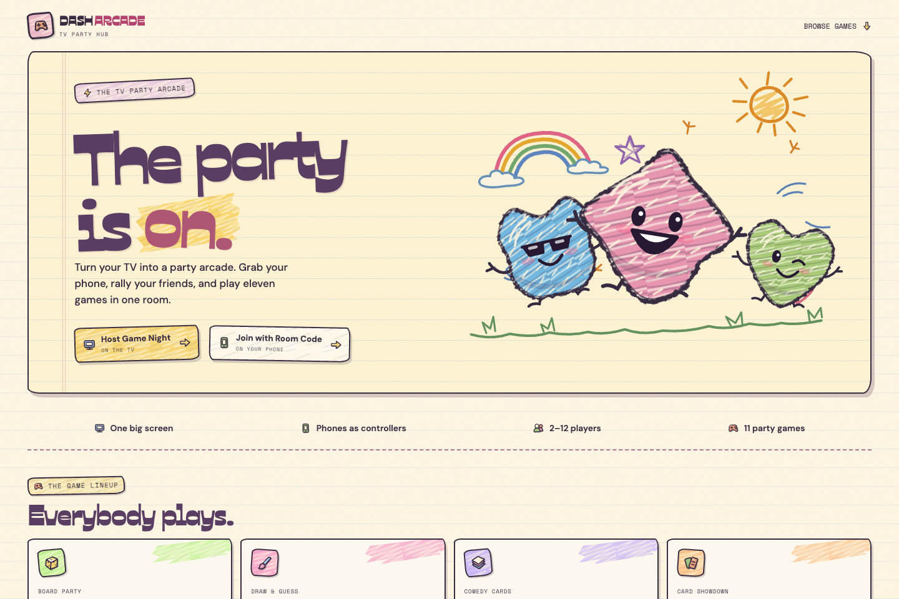

# Dash Arcade

Eleven multiplayer party games for one TV and 2–12 phone controllers, drawn in a crayon-and-pencil sketchbook style. Designed, engineered & built by Pratik Dash.

[Install the APK on your TV](docs/SETUP.md#install-on-google-tv-or-android-tv) · [TV and phone setup guide](docs/SETUP.md) · [Full source tree](FILE-TREE.txt)



## Quick start

```sh
git clone https://github.com/TwinSailsStudios/DASH-ARCADE.git
cd DASH-ARCADE
npm ci
npm run dev
```

Open [localhost:3000/host](http://localhost:3000/host), then use the lobby invite link in two additional tabs in the same browser profile. Ready up on both tabs to start a game. For a TV and separate phones, [configure HTTPS and Supabase](docs/SETUP.md#put-the-arcade-online-for-phones), then choose the instructions for your [TV](docs/SETUP.md#tv-operating-systems) and [phones](docs/SETUP.md#phone-and-tablet-operating-systems).

Dash Arcade uses Next.js and Supabase Realtime Broadcast and Presence. The TV host owns the room save in localStorage. Web builds include the phone PWA, and one Capacitor APK targets Android phones and Google TV. [Android build and install instructions](docs/SETUP.md#android-apk) · [Extract the preview APK](docs/SETUP.md#extract-the-preview-apk)

## Games

| Game | How it ends |
| --- | --- |
| Board Blitz | Six board rounds with alternating button-mash and quick-draw challenges |
| GuessSketch | Two drawing turns per player |
| Crazy Cards | First to ten card points |
| Color Clash | First to empty their hand |
| Bid & Brush | Two auctions per artist, followed by a final appraisal |
| Quiplash Clash | Players rotate through head-to-head prompts and vote |
| Fibbage Lies | Six rounds of lies mixed with true trivia |
| Split the Room | Each player writes one dilemma and scores for an even vote |
| Tee K.O. Brawl | Players draw, write, assemble shirts and vote through the bracket |
| Fakin’ It | Secret roles rotate across physical prompts |
| Trivia Dungeon | Six questions with alternating memory, math and wire challenges |

The first three finishers earn 5, 3, and 2 hub points. Everyone else who played gets 1. The host returns to the 60-second vote after each game. Select **End Game Night & Crown Winner** to reveal the podium. Credits are available from the lobby, voting screen, and podium. Opening Credits pauses the vote.

## Source and licenses

[FILE-TREE.txt](FILE-TREE.txt) lists all source, assets, and package files. The three reusable Pass 2 engines live in `src/engines/`. Each game registers its authority, controller projection, TV UI, and phone UI through `PartyGamePlugin`.

Project code is [MIT licensed](LICENSE). The bundled Kevin MacLeod recordings are [CC BY 4.0](public/music/CREDITS.md). The fonts have their own SIL Open Font License files under `public/fonts/`.
